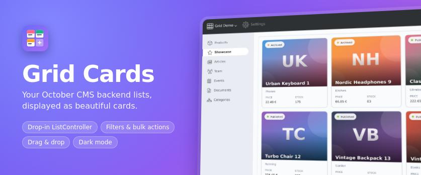
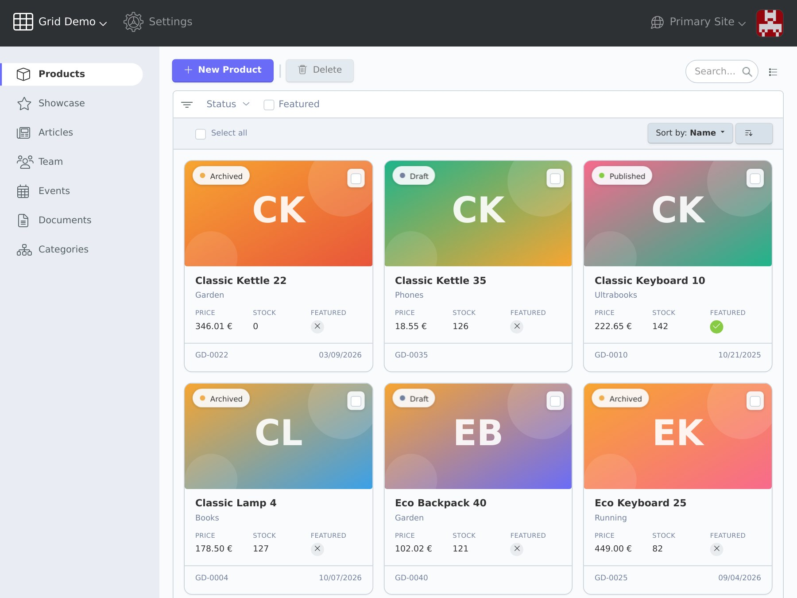
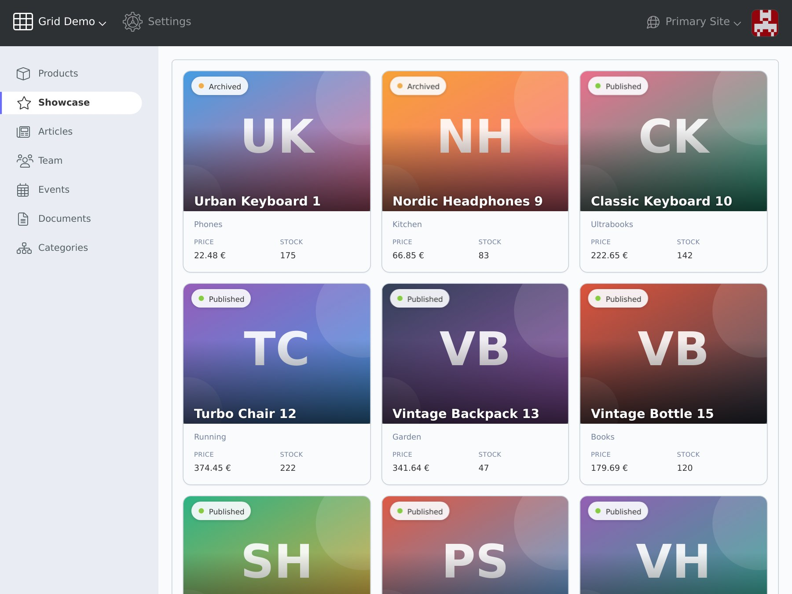
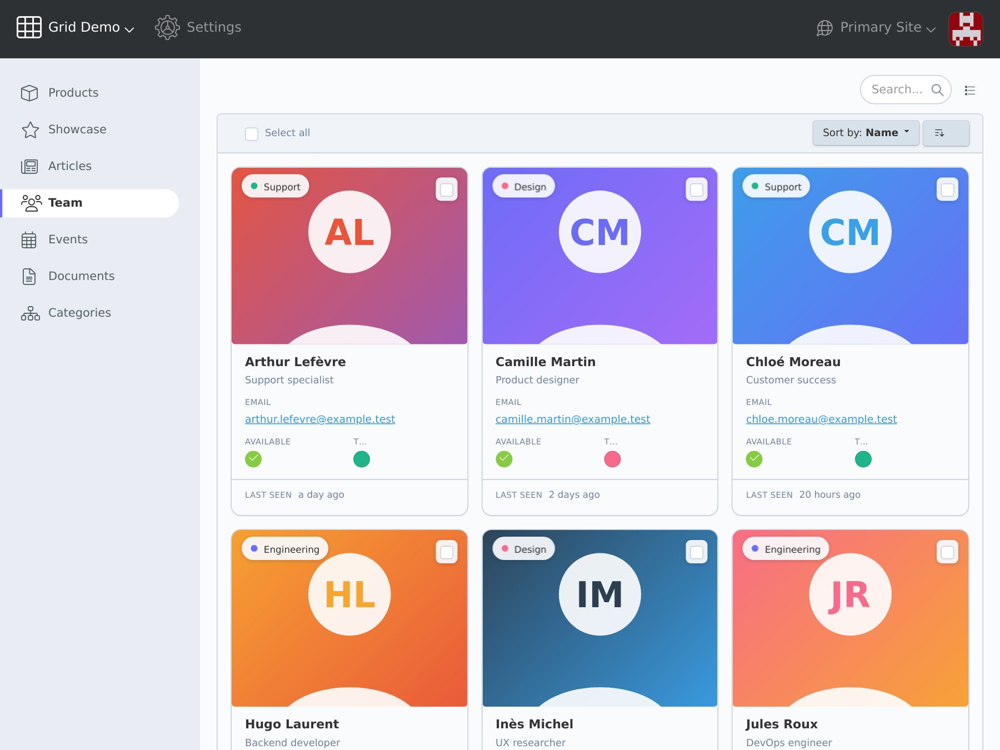
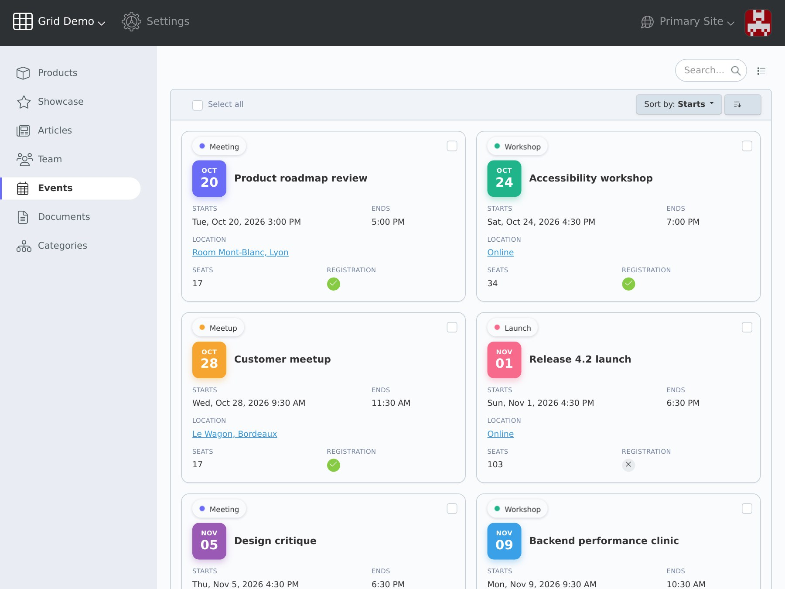
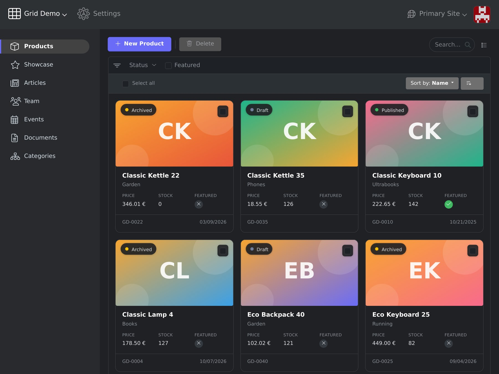

# Grid Cards for October CMS



Display the backend lists of October CMS 4 as a grid of cards instead of a table.

`GridController` is a drop-in replacement for the `ListController`: the configuration file, toolbar, search, filters, sorting, pagination, bulk actions, list setup, controller overrides (`listExtendQuery`, `listInjectRowClass`, …) and reordering keep working.

## Requirements

- October CMS 4.4 or later
- PHP 8.2 or later

## Installation

```bash
composer require lucaspalomba/grid-plugin
```

## Quick start

Replace the `ListController` behavior with the `GridController` and rename `$listConfig` to `$gridConfig`:

```php
public $implement = [
    \Backend\Behaviors\FormController::class,
    \LucasPalomba\Grid\Behaviors\GridController::class,
];

public $gridConfig = 'config_grid.yaml';
```

Then place the columns in the card:

```yaml
columns:
    cover:
        type: image
        cardSection: media
    status:
        type: selectable
        cardSection: badge
    name:
        cardSection: header
    price:
        type: number
        cardSpan: half
    stock:
        type: number
        cardSpan: half
    updated_at:
        type: timetense
        cardSection: footer
```

The view renders the grid like a list: `<?= $this->listRender() ?>`.

## Documentation

The full reference (card sections, field widths, grid options, layouts, reordering, customization) is in [docs/marketplace/documentation.md](docs/marketplace/documentation.md).

## Screenshots

| | |
|---|---|
|  |  |
|  |  |
|  |  |

## License

MIT
